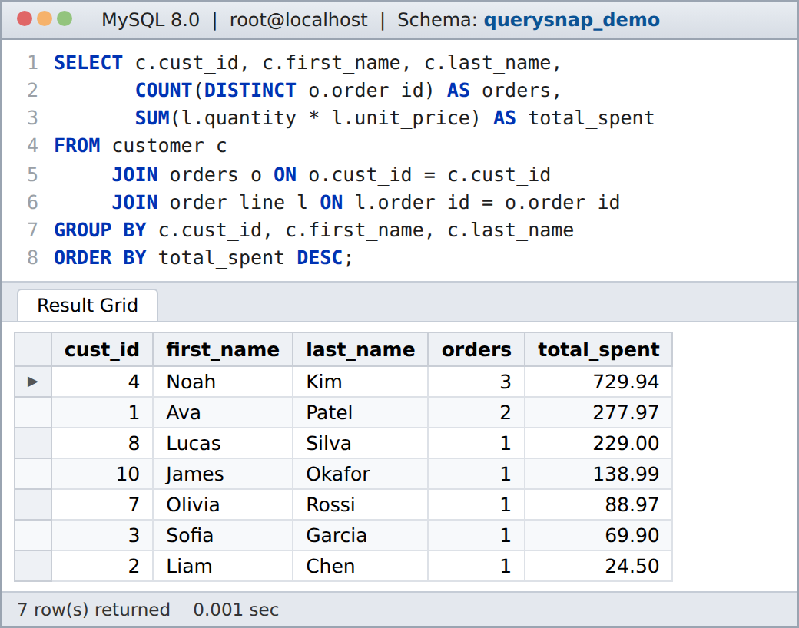
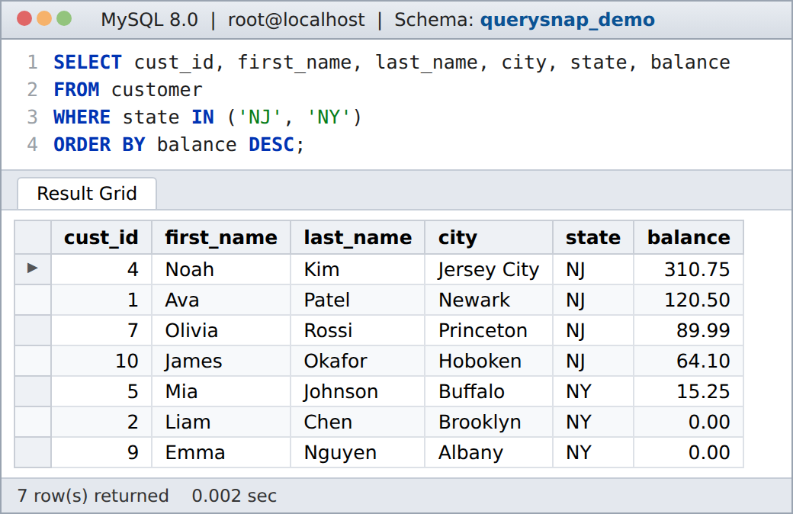
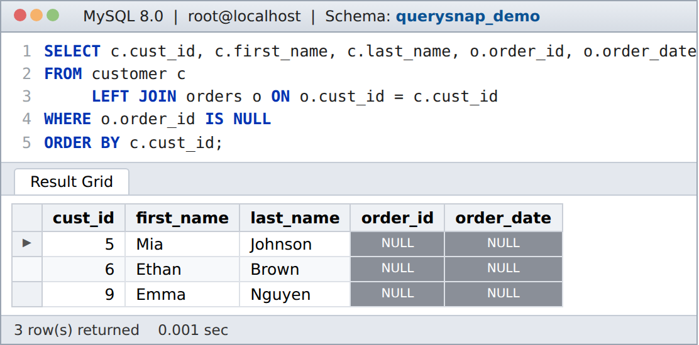
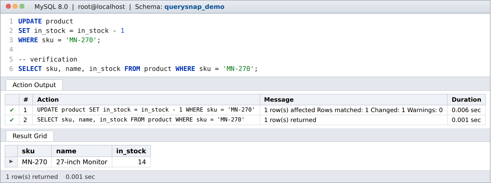
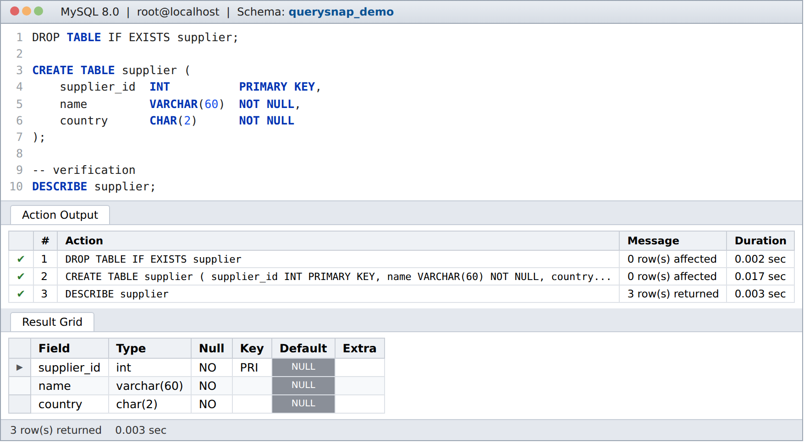

# QuerySnap

Run MySQL queries and save each query together with its result grid as a PNG screenshot.

QuerySnap reads a `.sql` file containing one or more numbered problems, runs every statement against a MySQL server, and renders a clean "SQL client" window for each problem: the query with line numbers and syntax highlighting, the Action Output log for `INSERT` / `UPDATE` / `DELETE` / DDL statements, and the Result Grid with row counts and timings. Every image shows real output from your database.



## Features

- One PNG per problem, rendered at 2× resolution for sharp images in documents and slides
- Numbered SQL editor with keyword, string and number highlighting
- Result Grid with right-aligned numeric columns and highlighted `NULL` values
- Action Output log (affected rows, server messages, duration) for statements that change data or structure
- Optional verification query after a change, so the screenshot shows the effect (for example a `SELECT` after an `UPDATE`)
- Large results are cut to the first 25 rows, with the full row count in the footer

## Requirements

- Node.js 20 or newer
- A MySQL 8.x server you can connect to
- Chromium for Playwright (installed below)

## Installation

```bash
git clone https://github.com/tentechle/querysnap.git
cd querysnap
npm install
npx playwright install chromium
```

## Configuration

Connection settings come from environment variables:

| Variable | Default | Description |
|---|---|---|
| `MYSQL_HOST` | `127.0.0.1` | Server host |
| `MYSQL_PORT` | `3306` | Server port |
| `MYSQL_USER` | `root` | User name |
| `MYSQL_PASSWORD` | *(empty)* | Password |
| `MYSQL_SOCKET` | — | Unix socket path (used instead of host/port when set) |
| `CHROMIUM_PATH` | Playwright's Chromium | Path to another Chrome/Chromium binary |

## Usage

1. Load the sample database (a small online shop):

   ```bash
   mysql -u root -p < examples/shop_demo.sql
   ```

2. Render the example problems:

   ```bash
   MYSQL_PASSWORD=yourpassword node snap.js examples/example-queries.sql screenshots
   ```

   Output:

   ```text
   ok    problem 1 -> screenshots/p1.png
   ok    problem 2 -> screenshots/p2.png
   ok    problem 3 -> screenshots/p3.png
   ok    problem 4 -> screenshots/p4.png
   ok    problem 5 -> screenshots/p5.png
   ```

`npm run snap` does the same for the example file.

If the database connection or a problem fails, its screenshot includes the database error and later problems still run when possible. The command exits with status `1` after rendering all screenshots when any problem fails, and `0` when every problem succeeds.

## Spec file format

A spec file is plain SQL with three comment markers:

```sql
-- @problem 4
-- @db querysnap_demo
UPDATE product
SET in_stock = in_stock - 1
WHERE sku = 'MN-270';
-- @verify
SELECT sku, name, in_stock FROM product WHERE sku = 'MN-270';
```

| Marker | Meaning |
|---|---|
| `-- @problem <n>` | Starts a new problem; the screenshot is saved as `p<n>.png` |
| `-- @db <schema>` | Database the problem runs in |
| `-- @verify` | Optional. Statements after this line run afterwards, and their result grid is shown in the screenshot |

Statements in a problem run in order on the same connection, so later problems see the changes made by earlier ones. End each statement with `;` at the end of a line.

## Examples

All of these come from [`examples/example-queries.sql`](examples/example-queries.sql) run against the sample database.

**Filter and sort**



**LEFT JOIN — customers without orders (`NULL` cells highlighted)**



**UPDATE with a verification query (Action Output + Result Grid)**



**CREATE TABLE followed by DESCRIBE**



## Project structure

```text
querysnap/
├── snap.js                    command-line entry point
├── runsql.js                  spec-file parser and MySQL runner
├── shots.js                   result window template and PNG rendering
├── examples/
│   ├── shop_demo.sql          sample database
│   └── example-queries.sql    example spec file
└── docs/screenshots/          images used in this README
```

## How it works

`runsql.js` splits the spec file into problems, connects with [mysql2](https://github.com/sidorares/node-mysql2), and runs each statement, recording result rows, affected-row counts and timings. `shots.js` builds an HTML window for each problem and captures it with [Playwright](https://playwright.dev/)'s headless Chromium.

## License

[MIT](LICENSE)
